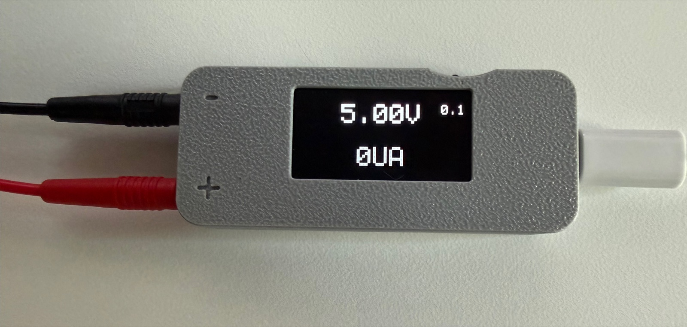
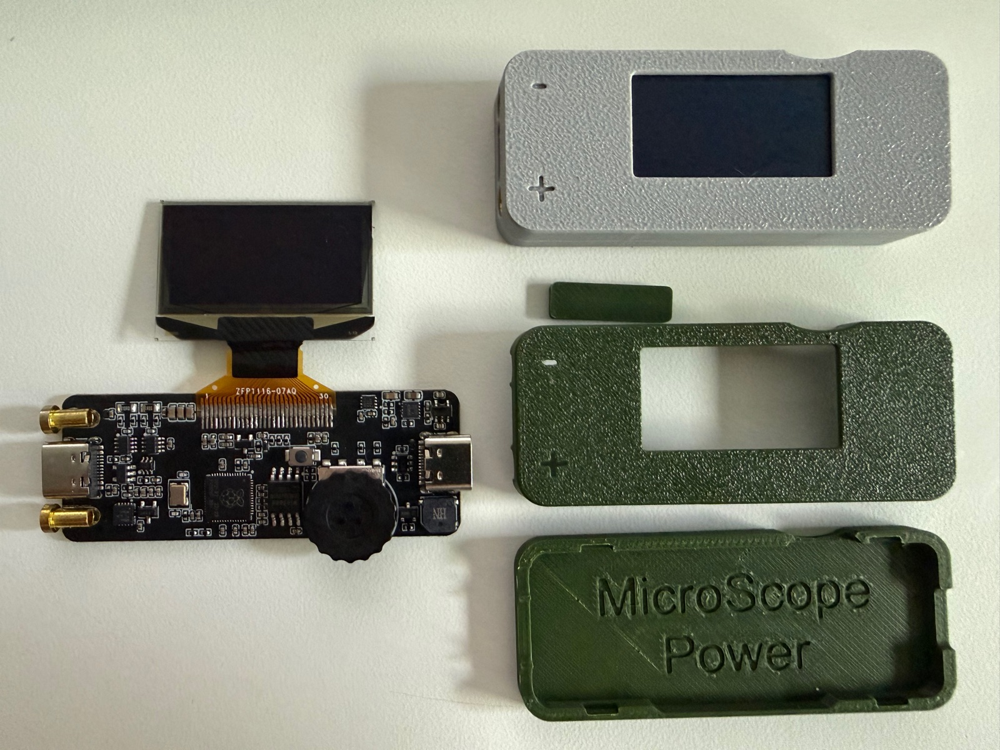
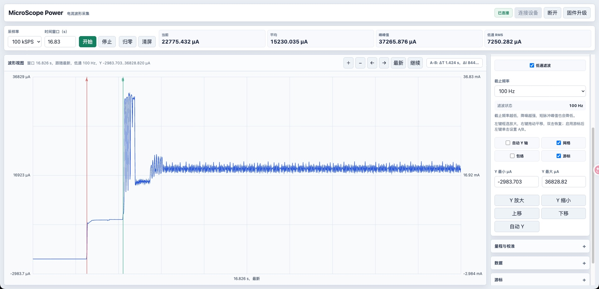

# MicroScope Power

基于 RP2040 的便携式可调电源与微电流波形分析仪固件。固件通过 ADS8866 读取 INA296A3 电流采样链路，通过 WebUSB 向 [ModuSignal 上位机](https://modusignal.cn/pages/devices/microscope-power/)上传数据。上位机源码、构建和测试统一在 [ModuSignal 仓库](https://github.com/txp666/modusignal)维护。

[立创开源项目：MicroScope Power 便携式可调电源与微电流波形分析仪](https://oshwhub.com/txp666/project_iupheygc)，含硬件工程、外壳模型和项目介绍。

## 实物与上位机

<table>
  <tr>
    <th>整机实物</th>
    <th>PCB、OLED 与外壳</th>
  </tr>
  <tr>
    <td align="center" width="50%">
      <a href="images/device.jpg"></a>
    </td>
    <td align="center" width="50%">
      <a href="images/hardware.jpg"></a>
    </td>
  </tr>
</table>

**ModuSignal 上位机**：电流波形、µA / mA 双轴、A/B 游标和可选截止频率的低通滤波。



## 目录

- `firmware/`: Pico SDK 固件工程。
- `tests/xiao_nrf52840_sense_plus/`: XIAO Sense Plus 综合测试固件、构建工具、固定大量程实测报告与图片。
- `docs/`: 接线、协议、使用和排障文档。
- `images/`: README 使用的实物照片与上位机截图。
- `scripts/`: Windows 环境检查、Pico SDK 拉取和固件构建脚本。
- `tests/firmware/`: 固件主机回归测试及硬件桩。
- `third_party/`: 本地 SDK/示例代码目录，`pico-examples` 只作为示例参考。

## 当前功能

- ADS8866 真实采样，支持 `10k / 20k / 50k / 100kSPS`。
- WebUSB 二进制帧上传，每帧 256 个 16-bit 原始 code。
- 采集中持续检测输出端电压，`GET_STATUS` 上传电压及设备时间戳；ModuSignal 自动计算功率与累计能量估算，支持统计 CSV 导出。
- 网页端按采样电阻、零点和 INA 增益换算为电流。
- 网页以 `μA` 显示电流、波形和统计。
- 支持自动量程和手动量程：
  - 大量程：默认 `1Ω`。
  - 小量程：默认 `10Ω`。
- 两个量程独立零点、独立采样电阻。
- 零点、两个电阻值、DAC 输出电压断电保存到 Pico flash。
- OLED 本地显示输出电压和空闲电流；输出电压按两位小数显示，右侧显示当前旋钮步进。
- OLED 开机动画和短提示音；上位机采集运行时本地不抢 ADS8866。
- DAC/LDO 输出通过本地旋钮调节，常用步进 `0.01 / 0.1 / 1 V`，输出电压带滤波显示。
- 上位机可让 Pico 进入 BOOTSEL/U盘模式，按住滚轮按键上电也可进入 BOOTSEL 升级 UF2。
- ADS8866 本地读取带超时保护，避免空闲显示路径卡住主循环。
- 网页端支持清屏、归零、暂停显示、自由缩放和平移、CSV/PNG 导出。

## 硬件默认引脚

详细接线见 [docs/wiring.md](docs/wiring.md)。

| 功能 | Pico GPIO |
| --- | --- |
| ADS8866 MISO | GP16 |
| ADS8866 CONVST/CS | GP17 |
| ADS8866 SCLK | GP18 |
| ADS8866 DIN | GP19 |
| 量程 SEL | GP20 |
| I2C SDA | GP8 |
| I2C SCL | GP9 |
| LDO EN | GP0 |
| LDO PG | GP1 |
| 编码器 A/B/KEY | GP6 / GP4 / GP5 |
| 蜂鸣器 | GP13 |
| 输出电压 ADC | GP26 / ADC0 |

## 构建固件

Windows 下建议直接使用脚本：

```powershell
powershell.exe -NoProfile -ExecutionPolicy Bypass -File .\scripts\check-env.ps1
powershell.exe -NoProfile -ExecutionPolicy Bypass -File .\scripts\bootstrap-pico-sdk.ps1
powershell.exe -NoProfile -ExecutionPolicy Bypass -File .\scripts\build-firmware.ps1
```

构建产物：

```text
build/firmware-ninja/pico_power_scope.uf2
```

按住 Pico `BOOTSEL` 插入电脑，把 UF2 拷贝到弹出的 Pico 盘符即可烧录。

已烧录过本固件后，也可以在网页上位机点击“固件升级”，让 Pico 自动重启到 BOOTSEL/U盘模式，再拷贝新的 UF2。

## CI 和 Release

GitHub Actions 会在 push、PR 和手动触发时编译固件，并上传构建 artifact。

打 `v*` tag 会自动创建 GitHub Release，并把固件产物作为 release assets 上传：

```powershell
git tag v0.2.1
git push origin v0.2.1
```

Release assets 包含：

- `pico_power_scope-<version>.uf2`
- `pico_power_scope-<version>.elf`
- `pico_power_scope-<version>.bin`
- `pico_power_scope-<version>.hex`
- `pico_power_scope-<version>.map`
- `pico_power_scope-<version>.txt`
- `SHA256SUMS.txt`
- `LICENSE`
- `THIRD-PARTY-NOTICES.txt`

固件版本来自 tag，例如 `v0.2.1` 会注入 `fw=0.2.1`；普通分支构建会使用 `VERSION+commit`。

## 打开上位机

使用 Chrome 或 Edge 打开 [modusignal 上位机](https://modusignal.cn/pages/devices/microscope-power/)，点击“连接设备”。连接设备后，先确认量程电阻值和零点，再开始采集。

本仓库只维护固件与设备协议；网页开发、构建和回归验证均在 modusignal 仓库进行。

使用 XIAO nRF52840 Sense Plus 作为被测负载，见 [综合测试程序与接线](tests/xiao_nrf52840_sense_plus/README.md)。同一个 UF2 在 USB 下输出外设自检结果，在 BAT 独立供电下执行约 18 秒负载序列后进入 System OFF。程序烧录到 XIAO，分析仪继续使用本仓库的 Pico 固件。固定大量程实测见 [功耗分析报告](tests/xiao_nrf52840_sense_plus/analysis-report.md)。

## 常用流程

1. 烧录固件，打开 [modusignal 上位机](https://modusignal.cn/pages/devices/microscope-power/)。
2. 点击“连接设备”。
3. 在“量程与校准”里确认大量程/小量程的采样电阻。
4. 空载或短接输入到零点状态，选择采样率并点击“开始采集”。
5. 收到当前量程的有效数据后点击“归零”。
6. 左键拖框放大、右键拖动平移；也可用滚轮或按钮缩放，双击恢复最新波形与自动 Y 轴。
7. 需要重新测量时点击“清屏”。

详细操作见 [docs/operation.md](docs/operation.md)。

## 协议

WebUSB 命令和二进制帧格式见 [docs/protocol.md](docs/protocol.md)。

## 回归验证

使用支持 C11/pthread 的本机 C 编译器：

```sh
sh scripts/run-firmware-tests.sh
bash scripts/run-usb-tests.sh
```

测试覆盖双核启停、SPI 超时、Flash 擦写保护及 USB 背压。GitHub Actions 同时运行这些测试和固件交叉编译。网页的拆包、应答、统计和绘图测试由 modusignal 运行。主机测试不能替代目标板上的采样时序、量程切换和断电保存验证。

## 许可证

本项目自有代码、文档及图片采用 [MIT 许可证](LICENSE)。第三方组件保留各自的许可证，详见子模块中的原始文件及 [第三方许可说明](THIRD-PARTY-NOTICES.txt)。固件发布包同时提供这两份许可文件。
