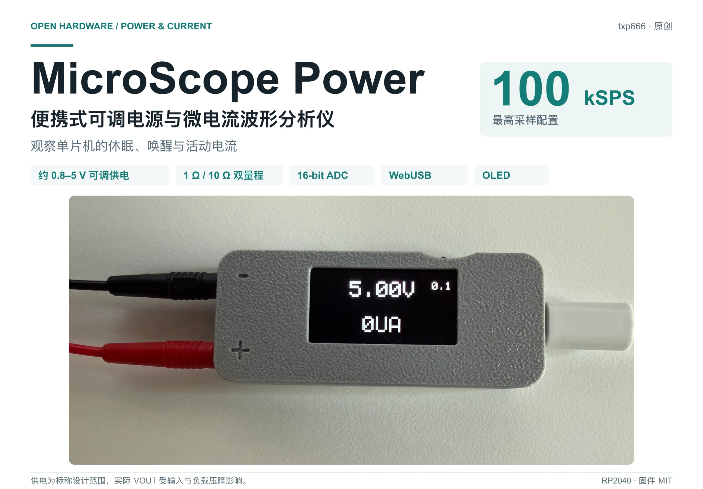
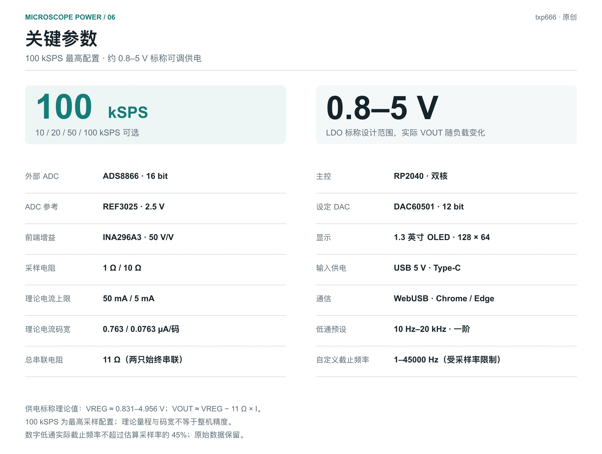
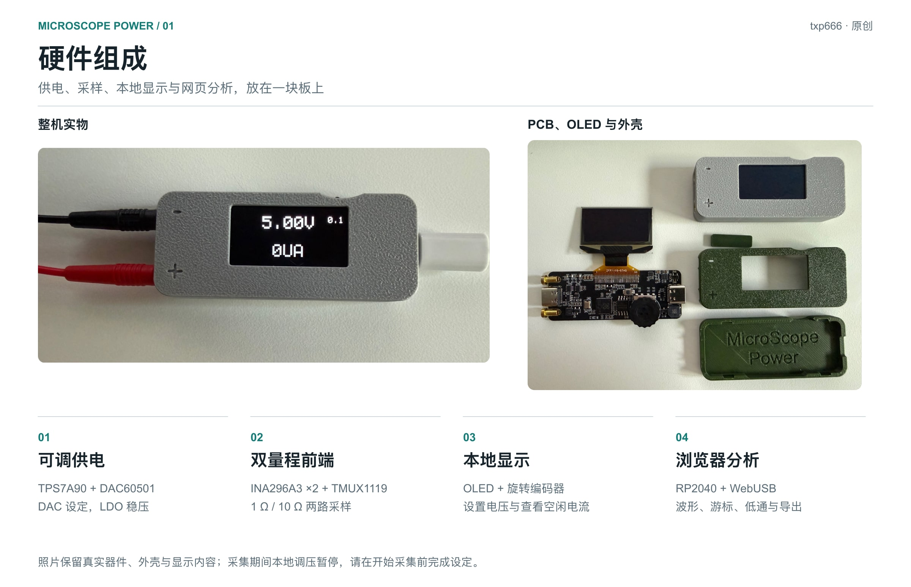
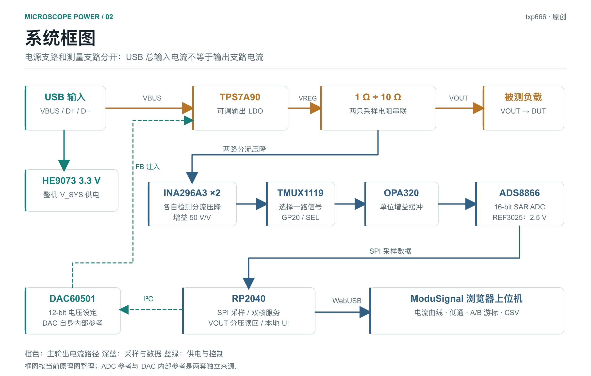
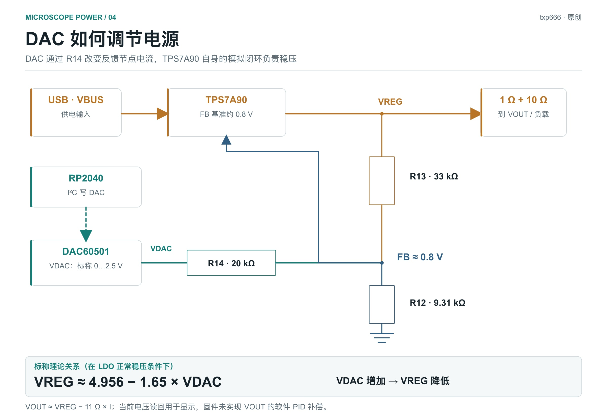
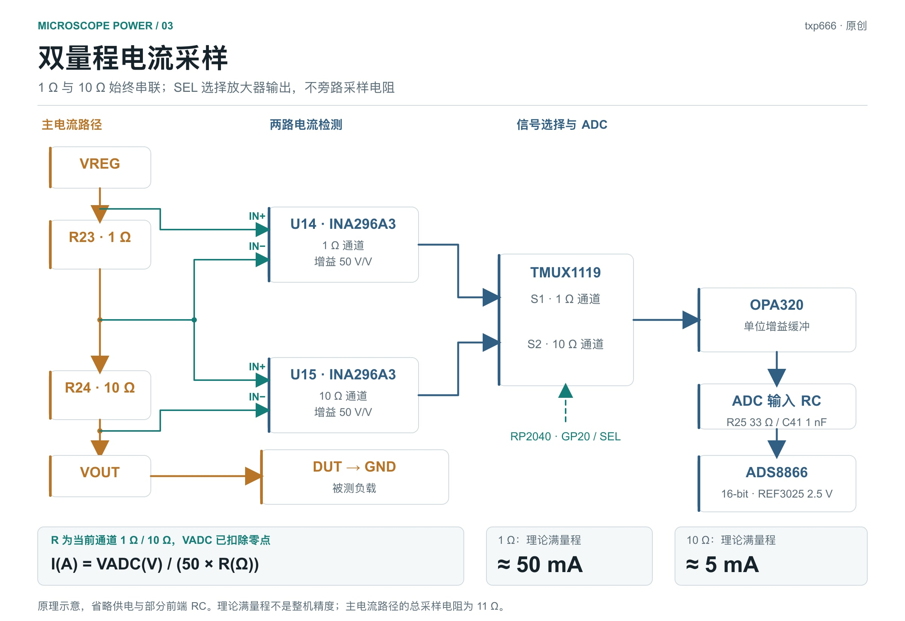
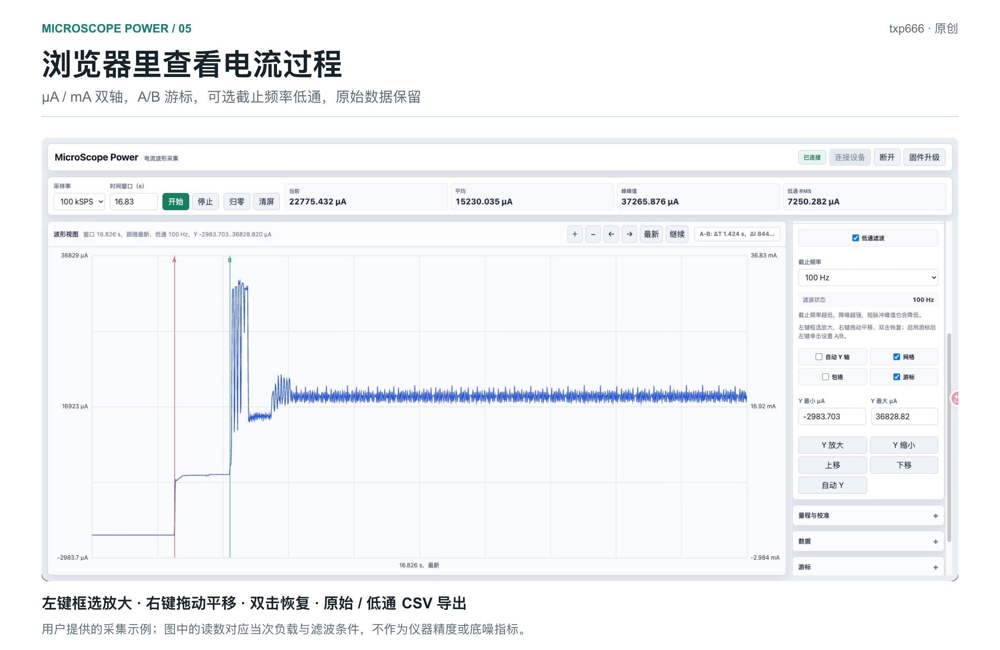

# MicroScope Power｜便携式可调电源与微电流波形分析仪

## 项目简介

调试低功耗单片机时，万用表可以读到一个平均电流，却不容易看清设备从休眠到唤醒的过程：什么时候启动外设、工作峰值持续多久、活动结束后有没有回到原来的电流水平。MicroScope Power 将可调供电、电流采集和网页波形放在一起，希望让这些变化更直观。

项目以 RP2040 为主控，用 DAC 设置 LDO 的输出，用外部 16 位 ADS8866 采集电流信号，**最高采样配置为 100 kSPS**。机身有 OLED 和旋转编码器，可以先在本地设置供电，再通过 USB 接入 ModuSignal 上位机查看波形。适合放在桌面上，用于单片机、传感器和小型电池设备的功耗实验，也适合学习模拟前端、ADC 驱动及浏览器与硬件通信。



便携式机身与浏览器波形查看。

## 核心功能

- **本地可调供电**：DAC60501 配合 TPS7A90，通过旋钮改变电压设定，OLED 显示输出端电压。
- **双量程电流观察**：默认 1 Ω、10 Ω 两路采样，支持自动或手动选择，两档电阻及零点独立保存。
- **16 位外部 ADC**：ADS8866 通过 SPI 接入 RP2040，采样率可配置为 10、20、50、100 kSPS，最高配置 100 kSPS。
- **WebUSB 上位机**：用 Chrome 或 Edge 连接设备，查看电流波形、均值、峰峰值和 AC RMS，左轴 µA 与右轴 mA 同步显示。
- **波形操作与游标**：左键框选放大，右键拖动平移，双击恢复；A/B 游标用于比较时间和电流差。
- **可选数字低通**：提供一阶低通及截止频率选择，支持自定义 Hz，保留滤波前数据，导出电流 CSV 或波形 PNG。
- **方便复刻和修改**：固件、网页源码、原理图、PCB 资料与外壳文件分开整理，UF2 固件通过 BOOTSEL 盘符烧录。

## 关键参数

| 参数 | 当前设计 / 配置 |
| --- | --- |
| 采样率 | 10 / 20 / 50 / **100 kSPS**，最高配置 100 kSPS |
| 可调供电范围 | **约 0.8–5 V，标称设计范围**；按反馈网络计算 VREG 约 0.831–4.956 V |
| 负载端电压 | VOUT 约为 VREG − 11 Ω × I，实际受 USB 输入、LDO 压差及负载影响 |
| 外部电流 ADC | ADS8866，16 位单端 SAR ADC |
| ADC 参考 | REF3025，独立 2.5 V 参考 |
| 电流放大 | 两颗 INA296A3，各 50 V/V；共用 OPA320 与一个 ADC |
| 双量程采样电阻 | 1 Ω / 10 Ω，始终串联；切换测量信号 |
| 正向理论满量程 | 大量程约 50 mA，小量程约 5 mA |
| 理论电流码宽 | 约 0.763 / 0.0763 µA/码，不是实测精度 |
| 电压设定 DAC | DAC60501，12 位，VDAC 标称 0–2.5 V |
| 主控 | RP2040，双核，SPI0 时钟配置 24 MHz |
| 本地显示与操作 | 1.3 英寸 OLED，128 × 64，旋转编码器 |
| 输入 / 输出接口 | USB Type-C 输入，输出 Type-C 与香蕉座共用 VOUT |
| 浏览器通信 | WebUSB，Chrome / Edge，HTTPS 或 localhost |
| 数字低通 | 一阶，10 Hz–20 kHz 预设，自定义 1–45000 Hz；有效值受实际采样间隔限制 |
| 导出 | 未经低通电流 CSV、低通 CSV、波形 PNG |
| 固件 / 上位机 | v0.2.1 / ModuSignal v1.0.4 |

这里的供电范围是按电路标称值计算的调节范围，使用时应以实际带载 VOUT 为准。ADC 位宽、理论码宽与显示小数位不能代替整机精度标定。



## 硬件组成

| 部分 | 主要器件 | 在本项目中的作用 |
| --- | --- | --- |
| 控制与通信 | RP2040、W25Q32JV | 采集调度、USB 通信、界面与配置存储 |
| 可调输出 | TPS7A90、DAC60501 | LDO 稳压与 DAC 电压设定 |
| 电流前端 | 1 Ω / 10 Ω、两颗 INA296A3 | 将电流转换为两种灵敏度的电压信号 |
| 信号选择与驱动 | TMUX1119、OPA320 | 选择一路 INA 输出并缓冲到 ADC |
| 转换与参考 | ADS8866、REF3025 | 16 位采样与独立 2.5 V ADC 参考 |
| 本地交互 | OLED、编码器、蜂鸣器 | 电压与空闲电流显示、设定及提示 |
| 机械与接口 | Type-C、香蕉座、3D 打印外壳 | USB 输入、负载供电与便携安装 |

USB 输入分成两条供电路径：一条产生整机使用的 3.3 V，另一条进入可调输出 LDO。输出 Type-C 和香蕉座连接同一个 VOUT 节点；输出 Type-C 用于供电，不是第二个 USB 数据口。



PCB、OLED、编码器与外壳结构。



供电路径与电流采集路径。

## 电路重点

### 1. DAC 怎样让 LDO 的电压可调

TPS7A90 的内部误差放大器会调节输出，使 FB 反馈节点接近 0.8 V。本项目保留这个模拟稳压环路，并在反馈网络加入 DAC 电压。VREG 通过 33 kΩ 接 FB，FB 通过 9.31 kΩ 接地，VDAC 再通过 20 kΩ 接入 FB。改变 VDAC，就相当于改变反馈节点中另一条支路的电流。

忽略元件误差并假设 LDO 已进入稳压状态，可得到：

```text
VREG ≈ 4.956 − 1.65 × VDAC    （单位 V）
```

所以这里的调节方向是 **VDAC 增大，VREG 减小**。DAC 设置为 0～2.5 V 时，VREG 的理想对应值约从 4.956 V 降到 0.831 V。实际输出还会受到 USB 输入、线缆压降、LDO 压差和负载影响，使用时直接查看输出端读数更合适。

DAC60501 是 12 位 DAC，采用自身内部 2.5 V 参考，I²C 接到 RP2040 的 GP8、GP9。固件将毫伏设定换成 DAC 数据写入，GP0 控制 LDO 使能，GP1 读取 Power Good。这里没有 MCU 电压 PID：稳压由 LDO 的模拟环路完成，RP2040 的输出电压 ADC 负责读回和显示。

OLED 读回点是负载端 VOUT，而 LDO 反馈取自 VREG，中间隔着采样电阻。旋钮当前切换的 0.01、0.1、1 V 步进作用于 DAC 设定；输出端的变化还要乘上反馈网络关系，不能把这几个数字理解为输出电压精度。



DAC 反馈注入与输出端电压读回。

### 2. 两档量程选择的是信号，不是电阻

主电流路径是：

```text
VREG → 1 Ω → 10 Ω → VOUT → 被测负载 → GND
```

两只采样电阻始终串联，每只电阻分别用 Kelvin 连接引到一颗 INA296A3。两颗放大器的增益都是 50 V/V，因此相同电流下，10 Ω 通道产生的电压是 1 Ω 通道的十倍，更适合观察较小电流。

TMUX1119 位于两颗 INA 的输出侧。GP20 控制它选择 1 Ω 或 10 Ω 通道，选中的小信号再进入同一个 OPA320。切换量程时没有把任何采样电阻短接，也没有两路 ADC 同时采集；这是两路模拟前端共用一条转换链。

这种结构容易理解，但主电流路径一直存在 11 Ω。理想情况下，负载端电压比 VREG 少 `I × 11 Ω`，例如 50 mA 时约少 0.55 V。给 DUT 设定电压时，要关注带负载后的 VOUT，也要考虑采样电阻的功耗。

### 3. 放大器、缓冲器与 ADC 各做什么

INA296A3 将分流电阻两端的小压差放大。输入侧的电阻和差分电容帮助处理高频干扰；TMUX 完成通道选择；OPA320 接成单位增益跟随器，提供 ADC 输入需要的驱动能力，而不再增加 50 倍之外的电流增益。OPA 输出经过 33 Ω、1 nF 网络进入 ADS8866。

ADS8866 的转换参考来自独立 REF3025，名义值为 2.5 V。它与 DAC60501 的内部参考是两套参考源：一个决定电流采样的 ADC 量程，另一个服务输出电压设定。INA 的参考端接地，则是在设置放大器的输出偏置，不能与 ADC 的 REF 引脚混为一谈。

按 2.5 V 参考、50 倍增益和标称电阻计算：

| 测量通道 | 正向理论满量程 | 理论电流码宽 |
| --- | ---: | ---: |
| 1 Ω 大量程 | 约 50 mA | 约 0.763 µA/码 |
| 10 Ω 小量程 | 约 5 mA | 约 0.0763 µA/码 |

这些都是理想电路计算值，码宽描述相邻 ADC 码对应的电流间隔，并非整机测量精度或实测最小可分辨电流。参考误差、放大器偏移、采样电阻、噪声和零点都会影响最后读数。网页显示到小数点后三位，也不改变这些物理条件。



串联分流、两路 INA 与单 ADC 复用。

### 4. 为什么空载也要做零点处理

VOUT 还接了 100 kΩ / 100 kΩ 电压检测分压网络，它本身也是一个负载。在 3.3 V 下，这条支路的理论电流约为 16.5 µA，并且经过前面的两个采样电阻。输出保护、输入偏置和漏电也会影响空载读数，因此“输出没接设备”不意味着整条输出支路没有电流。

上位机允许每个量程独立归零，用空载基线补偿当前偏移。分压电流会随输出电压变化，换一个供电电压后最好重新确认零点。外部 USB 电流表测到的整机输入电流还包括 RP2040、OLED、模拟前端等，与网页上的输出支路电流是两个不同测量位置。

## 使用与源码

建议先用固定电阻负载熟悉量程和波形，再接入目标单片机。先在本地设置供电并检查 VOUT，再打开 ModuSignal 设备页连接硬件。根据实装电阻填写校准值，分别选择两档量程采集空载数据并归零。固件会保存电阻、零点和 DAC 设定，采集期间延后 Flash 写入，停止后再保存。

看休眠与唤醒过程时，可以先固定 1 Ω 大量程、关闭低通，记录活动过程；只观察休眠稳态时，再确认 10 Ω 小量程不会饱和。注意 DUT 的调试 USB 或其它供电线可能让一部分电流绕开采样路径。当前采集中本地调压和界面更新暂停，先调压再采集，或停止后调节。

网页左键拖框放大需要的片段，右键拖动查看邻近波形，启用游标后比较 A/B 的时间和电流差。“暂停显示”仍继续接收数据，“停止”才结束采集。导出前把想保留的波形放在当前窗口，CSV 和 PNG 都按该窗口输出。

一阶数字低通提供 10 Hz～20 kHz 常用选项，也可以输入 1～45000 Hz，实际频率受采样间隔限制。曲线、游标和统计使用同一份滤波结果，便于对照。截止频率低时稳态读数更平缓，短脉冲峰值也会被压低、边沿变慢；分析唤醒尖峰时应同时保留未经低通的波形。

这里的“原始 CSV”是 **未经低通、按校准换算后的电流**，不是 ADC 码。低通 CSV 另外保留原始电流列和有效截止频率，方便后续用自己的脚本分析。RMS 是窗口去均值后的 AC RMS，若窗口含有活动过程，它也会把真实电流变化计入，适合选取纯休眠区间做对比。

直接使用时，从固件 v0.2.1 页面下载 UF2，按住 BOOTSEL 接入 USB，复制到枚举盘符即可。已经运行本固件的设备，也能通过网页“固件升级”进入 BOOTSEL。上位机支持在线使用，或下载 ModuSignal v1.0.4 离线包，用 Python 本地服务打开；Chrome、Edge 的 WebUSB 需要 HTTPS 或 localhost。

源码构建分为两个仓库：固件使用 Pico SDK、CMake 和 Arm GNU 工具链，网页使用 Node.js 与 npm。固件命令示例为 `cmake -S firmware -B build/firmware-release -G Ninja`，按工程说明配置 SDK 后构建；网页执行 `npm ci`、`npm test`、`npm run build`、`npm run preview`。详细环境与引脚说明放在仓库文档中，便于按自己的系统操作。

## 实物与测量示例

外壳分为上盖、底壳和挡板，方便把屏幕、旋钮、PCB 与接口组合起来。仓库提供 STEP 文件，复刻时可以按手上的打印机、材料和装配间隙修改；电路部分也可以先裸板调试，再完成外壳安装。



活动电流波形、A/B 游标与低通设置。

图中的电流平台和尖峰用于展示波形查看方式，不作为固定负载的规格或整机底噪测试。实际实验中，先记录“休眠—唤醒—活动—回到休眠”的完整过程，再分段放大，通常比只读一个平均值更容易定位多余唤醒和持续活动的原因。

## 当前边界与后续方向

100 kSPS 是最高配置目标。当前每点有约 9 µs 转换等待，还要读取 SPI 并执行软件处理，实际间隔不一定恒为 10 µs。网页按相邻帧时间戳估计采样间隔，时序超限与真实数据缺口分别显示。自动换档还有稳定等待，需要关注很短的唤醒边沿时，固定合适量程更容易解释波形。

现在的输入 RC 和网页低通也不等同于完整的模拟抗混叠方案。进一步提高测量质量，优先考虑 ADC 参考电容及局部回流、INA 保留脚处理、缓冲器与输入 RC 的布局，再验证前端带宽和动态响应。当前资料给出理论量程与电路结构，不以滤波后的平滑曲线代替整机精度、底噪或输出纹波测试。

11 Ω 串联压降和输出端分压的影响同样值得在下一版优化。若希望扩大电流范围或更好地保持 DUT 端电压，需要同时调整功率路径与采样方式；数字滤波解决的是采样后的带宽选择，不能补回供电压降。

## 开源入口

- [固件、硬件与外壳资料](https://github.com/txp666/MicroScope-Power)：当前固件 **v0.2.1**，自有内容采用 **MIT**，第三方组件保留各自许可证。
- [固件 v0.2.1 下载](https://github.com/txp666/MicroScope-Power/releases/tag/v0.2.1)：UF2、校验清单和许可文件。
- [ModuSignal 上位机源码](https://github.com/txp666/modusignal)：当前版本 **v1.0.4**，采用 **Apache 2.0**。
- [ModuSignal v1.0.4 离线包](https://github.com/txp666/modusignal/releases/tag/v1.0.4)：本地浏览器运行。
- [在线 MicroScope Power 上位机](https://modusignal.cn/pages/devices/microscope-power/)：连接设备并查看波形。

欢迎结合自己的低功耗项目复刻、改进电路或扩展软件，把测量条件、波形与修改一起分享，方便大家比较结果。

器件参考资料：[TPS7A90](https://www.ti.com/lit/ds/symlink/tps7a90.pdf)、[DAC60501](https://www.ti.com/lit/ds/symlink/dac60501.pdf)、[INA296](https://www.ti.com/lit/ds/symlink/ina296a.pdf)、[TMUX1119](https://www.ti.com/lit/ds/symlink/tmux1119.pdf)、[OPA320](https://www.ti.com/lit/ds/symlink/opa320.pdf)、[ADS8866](https://www.ti.com/lit/ds/symlink/ads8866.pdf)、[REF3025](https://www.ti.com/lit/ds/symlink/ref30.pdf)。
