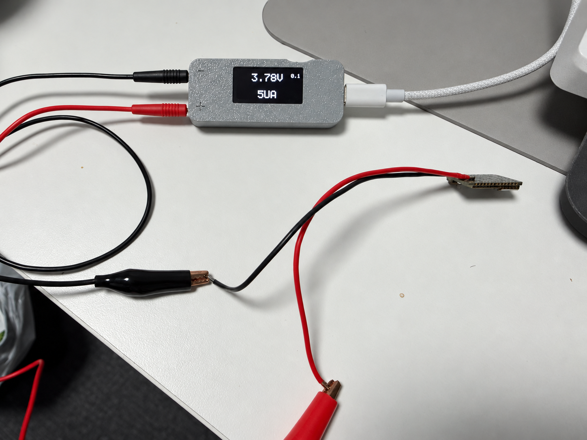
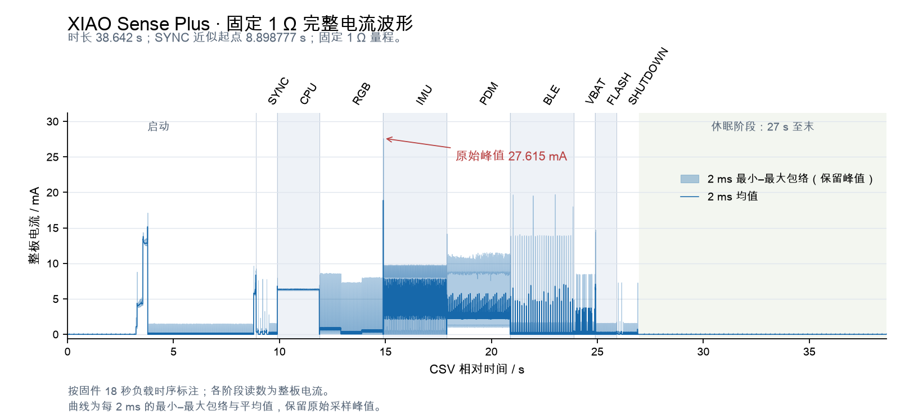

# XIAO nRF52840 Sense Plus 功耗测试报告

测试日期：2026 年 10 月 15 日　｜　固件：`XIAO-COMBINED-3`

## 与官方数据对比

| 项目 | Seeed 官方标称 | 本次实测 | 差异 |
| --- | ---: | ---: | --- |
| 待机 / 休眠电流 | **小于 5 µA** | **5.82 µA** | 比 5 µA 界限高 **0.82 µA，约 16.4%** |

官方数值来自 [Seeed XIAO nRF52840 系列说明](https://wiki.seeedstudio.com/XIAO_BLE/#features)。本次取 **27.00–38.64 s** 的全部样本计算休眠均值，包含期间的短脉冲。

**实测读数高于官方标称界限。** 本次使用固定 1 Ω 大量程，电流读数步进约 0.76 µA；供电条件、零点及测量误差尚未与官方测试对齐，判断是否达标还需小量程校准测量。

官方页面未给出与本程序对应的 CPU、IMU、麦克风及 BLE 活动阶段整板电流，因此这些项目列出实测值供参考。

## 测试条件

使用 MicroScope Power 测量 XIAO nRF52840 Sense Plus，BAT 独立供电，固定 **1 Ω 大量程**，采样率选项 **100 kSPS**。界面电压输入值为 **3.782 V**，完整记录约 **38.64 s**。

*实物照片整理版，用于展示设备与接线布置；照片中的屏幕示值不参与统计。*

## 实测结果

*曲线显示每 2 ms 的均值及最小—最大值包络，保留短时峰值。阶段按固件时序标注。*

| 测试阶段 | 整板平均电流 |
| --- | ---: |
| CPU 连续运算 | 6.33 mA |
| RGB 红 / 绿 / 蓝灯 | 762 / 220 / 442 µA |
| IMU 六轴采样 | 3.64 mA |
| PDM 麦克风采集 | 2.41 mA |
| BLE 广播 | 261 µA |
| 电池电压采样 | 252 µA |
| Flash 检查后的时槽等待 | 36.1 µA |
| 休眠 | **5.82 µA** |

各活动阶段取内部稳定窗口统计，数值包含 MCU 和板上外围电路的总电流。全程平均电流约 **0.998 mA**，最大采样值为 **27.62 mA**，出现在 IMU 阶段开始附近。休眠阶段各分窗均值为 **5.81–5.83 µA**。

## 时间与程序核对

**主要阶段的时间与程序安排对应。** 三次蓝灯 SYNC 标记的参考起点约为 CSV 的 **8.899 s**，程序的 18 秒测试序列从这里开始。表中实测时刻由原始电流边沿提取。

| 阶段 | 程序开始时间（相对 SYNC） | 波形开始时间（CSV） |
| --- | ---: | ---: |
| CPU | 1 s | 9.898 s |
| RGB | 3 s | 11.898 s |
| IMU | 6 s | 14.898 s |
| PDM 麦克风 | 9 s | 17.898 s |
| BLE 初始化 | 12 s | 20.898 s |
| 电池电压采样 | 15 s | 23.898 s |
| Flash 检查 | 16 s | 24.898 s |
| 收尾绿灯标记 | 17 s | 25.898 s |

CPU 连续负载实际持续 **1.980 s**；RGB、IMU、PDM 活动各约 **2.98 s**，与程序为这些阶段预留约 **20 ms** 收尾和等待一致。Flash 检查的主要活动约 **22.4 ms**，其 1 秒时槽的其余时间用于等待。

收尾的两次绿灯电流响应各约 **79 ms**，对应程序的 80 ms 标记。序列结束附近的 **26.897 s** 与 **26.907 s** 两次软件活动相隔约 **10.015 ms**，与代码末尾的 10 ms 延时对应；约 **26.908 s** 转入休眠，即 SYNC 后约 **18.009 s**。

以上时刻按 CSV 插值时间轴估计，主要阶段在毫秒级吻合；首个 SYNC 与初始化活动相接，因此参考起点取近似值。

## 结论

- **程序时序：** 各阶段顺序、活动时长，以及 18 秒序列后的约 10 ms 收尾延时，均能在本次波形中对应。
- **板卡功耗：** 休眠平均电流为 **5.82 µA**，比官方 5 µA 界限高约 **16.4%**。目前不能确认达到官方待机指标，需在校准后用小量程复核。
- **分析仪表现：** 本次成功记录了各负载阶段、短时峰值及休眠电流变化，验证了对这些负载变化的采集能力；绝对测量精度仍需参考负载校验。

数据来源：`pico-power-scope-2026-10-15T13-19-44-043Z.csv`。

[上位机截图](images/capture.png) · [详细统计](data/analysis.json) · [测试程序与接线说明](README.md)
